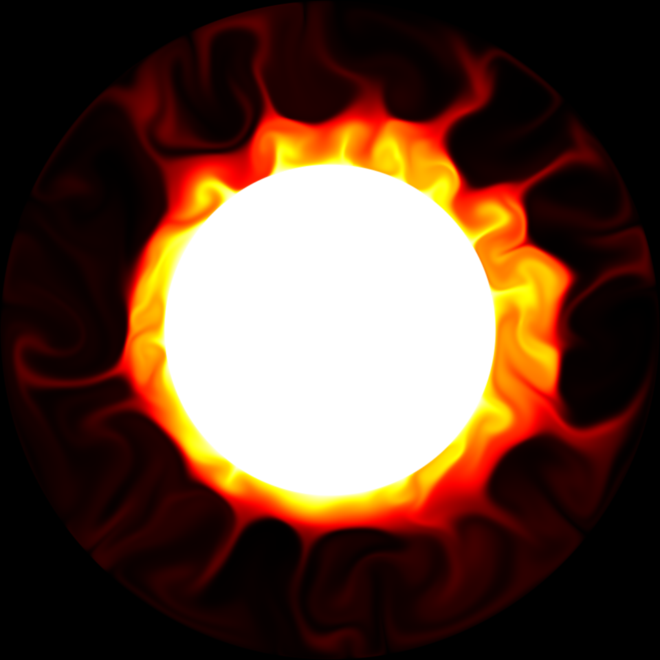

# Interactive Earth



Interactive Earth is a teaching tool for demonstrating mantle convection and its dependence on Rayleigh number.
It enables a mantle convection model to be run much more quickly than the codes typically used in research.
It solves the same governing equations, but makes comprimises for accuracy for the sake of achieving speed.
This speed enables the code to be very responsive to user input.

The simulations can be run in a browser without running any local code [here](http://ian-r-rose.angithub.io/interactive_earth/thermal_hires.html).

More about the project can be found [here](http://ian-r-rose.github.io/interactive_earth/about.html).

An introduction to the underlying science can be found [here](http://ian-r-rose.github.io/interactive_earth/explanation.html).

## Building

The build uses CMake. The easiest way to get a known-good toolchain
(compiler, CMake, Ninja, FFTW, SDL2, GLEW) is [pixi](https://pixi.sh),
which installs pinned versions from `pixi.lock` into the project directory:

```
pixi run start    # build and run the interactive app
pixi run test     # physics regression tests
pixi run bench    # headless solver benchmark, e.g. pixi run bench --ra 1e6 --threads 1
```

Without pixi, install those dependencies however you like and use the presets directly:

```
cmake --preset native-release
cmake --build --preset native-release
ctest --preset native-release
./build/native-release/interactive_earth
```

There is also a `native-debug` preset with AddressSanitizer and UndefinedBehaviorSanitizer.

## Building for the web

The WebAssembly build uses the Emscripten SDK version pinned in `.emsdk-version`,
which `pixi run setup-emsdk` installs into `.emsdk/`. FFTW is downloaded and built
from source with the same toolchain.

```
pixi run setup-emsdk   # once
pixi run build-wasm
pixi run serve-wasm    # then open http://127.0.0.1:8000
pixi run test-wasm     # run the physics tests under node
pixi run bench-wasm    # single-threaded benchmark under node
```

`web/dev.html` is a minimal page for local testing; add `?log` to the URL to also
log the timing overlay to the console.

## User input
With the simulation running, the user can make the following changes:
- put in positive temperature anomalies (add heat) by clicking
- put in negative thermal anomalies (remove heat) by right-clicking
- change the Rayleigh number (the vigor of convection) by scrolling
- press space to pause the simulation. while it is paused one can click to add earthquakes.

## Changing simulation behavior for advanced users
The behavior of the simulation can be modified by changing parameters within the upper part of `src/main.cpp`. The parameters that readily exposed for being modified include:
- the resolution of the simulation (and thereby how quickly it runs)
- whether or not to do a true polar wander (TPW) calculation
- whether to included a chemical field
- whether to render the simulation with flattened with an equatorial bulge
